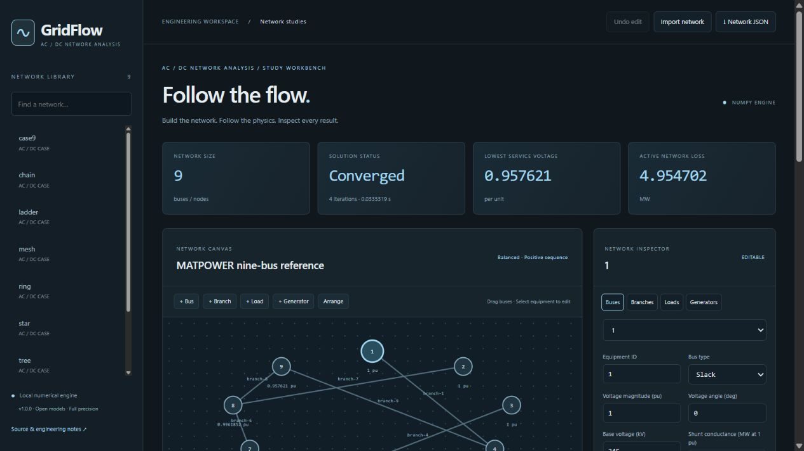

# GridFlow

**Balanced AC/DC load flow with transparent numerical methods and an editable network workbench.**

[](https://github.com/VictorOdoyo/gridflow/actions/workflows/ci.yml)
[](https://www.python.org/)
[](LICENSE)

GridFlow combines a reusable NumPy engineering library, JSON CLI and local interactive network editor. It records convergence diagnostics and model assumptions. Failed solves stay failed; the application never hides a different algorithm behind the requested method.



## Run locally

```sh
git clone https://github.com/VictorOdoyo/gridflow.git
cd gridflow
python -m venv .venv
# PowerShell:
.venv\Scripts\Activate.ps1
# Linux/macOS: source .venv/bin/activate
python -m pip install -e .
python -m gridflow serve
```

Open **http://127.0.0.1:8766**. Select an example, edit equipment in the inspector or native JSON editor, and run a study. The SVG network supports bus dragging and equipment selection. Add/delete equipment, undo edits, export network/result JSON and print reports. Layout coordinates do not change the electrical model. The browser uses local assets and loopback requests only.

## Engineering capabilities

- Explicit bus, line/transformer, load and generator models with island detection.
- Y-bus construction with pi charging, complex off-nominal taps, phase shifts and bus shunts.
- Damped analytic Newton-Raphson, Gauss-Seidel and FDXB fast-decoupled AC solvers.
- Slack/PV/PQ buses with aggregate PV reactive-limit enforcement and recorded PV-to-PQ transitions.
- Linear DC load flow with tap/phase-shift injections and branch utilization estimates.
- Both-end branch powers, system losses, voltage profiles, mismatch histories and solver comparisons.
- Analytic local injection sensitivities and pseudo-arclength continuation with predictor/corrector diagnostics.
- Native JSON, explicit CSV table and numeric-literal MATPOWER subset import/export.

## Python and CLI

```python
from gridflow.cli import load_case
from gridflow.solver import solve

network = load_case("example:triangle")
result = solve(network)
assert result["converged"], result["reason"]
print(result["losses_mw"])
```

```sh
python -m gridflow examples
python -m gridflow study example:triangle
python -m gridflow study network.json --action compare --output study.json
python -m unittest discover -s tests -v
```

`--options` accepts a JSON object with the selected study's arguments. The [CLI contract](docs/cli.md) explains exit status and stdin. The [local API](docs/http.md) supports the same study functions. Model units and import rules are in [schema documentation](docs/schema.md).

## Independent verification

The repository contains **56 synthetic reference networks**, each with input data, expected numerical values, a dedicated regression test and an engineering note. Reference phasors are prescribed first; independent circuit-current equations derive the required injections and both-end branch powers. All three AC methods must recover those prescribed values. These are explicitly labeled synthetic verification circuits, not IEEE benchmark feeders or laboratory measurements. The analytical/unit/integration suite also checks invalid models, topology, conservation, transformations and study APIs.

See [benchmark methodology](docs/validation.md) and [benchmark cases](benchmarks). Expected values are checked in, so normal tests need only NumPy. The reference generator does not import the production solver.

An additional [upstream MATPOWER nine-bus case](docs/matpower_case9.md) is verified against an independent PYPOWER solution for bus phasors and both-end branch powers. Its upstream license is retained with the data.

## Model boundaries

The AC model is balanced positive sequence. Voltage and thermal limits are reported, not enforced by optimization. Reactive bounds apply to aggregate PV generation; slack Q/P limits and detailed capability curves are not enforced. FDXB can fail on high R/X or stressed circuits. DC ignores losses and voltage/reactive effects. Continuation holds bus types fixed and disables reactive-limit switching; a sampled fold is not a secure operating margin. Sensitivities hold the solved active set fixed. MATPOWER support is a documented subset, not executable MATLAB or full feature parity.

The standard-library server binds to 127.0.0.1 for a trusted local workstation. It is not a hardened public hosting service. Numerical libraries use dense matrices; large network production studies require additional sparse methods and validation. Browser drafts stay in local storage; JSON exports preserve durable study snapshots. The MIT license does not certify an electrical design.

## Architecture

The package separates model validation, topology, electrical equations, solvers, metrics, advanced studies, CLI/HTTP adapters and browser assets. Tests never obtain expected values by calling the production implementation. Focused commits separate model behavior, independent validation and engineering documentation. See [contribution guide](CONTRIBUTING.md).

Created by Victor Odoyo. Related project: [PowerCalcs](https://github.com/VictorOdoyo/powercalcs).
